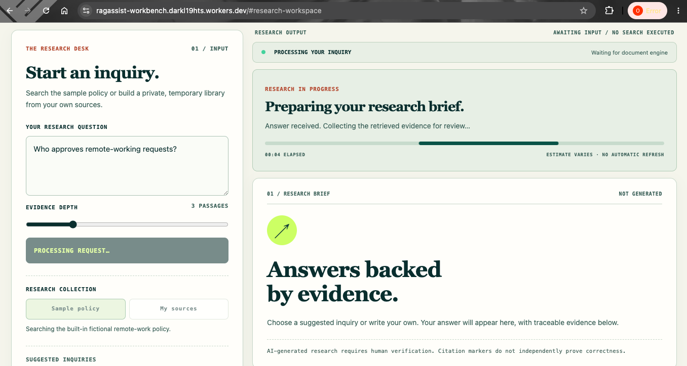
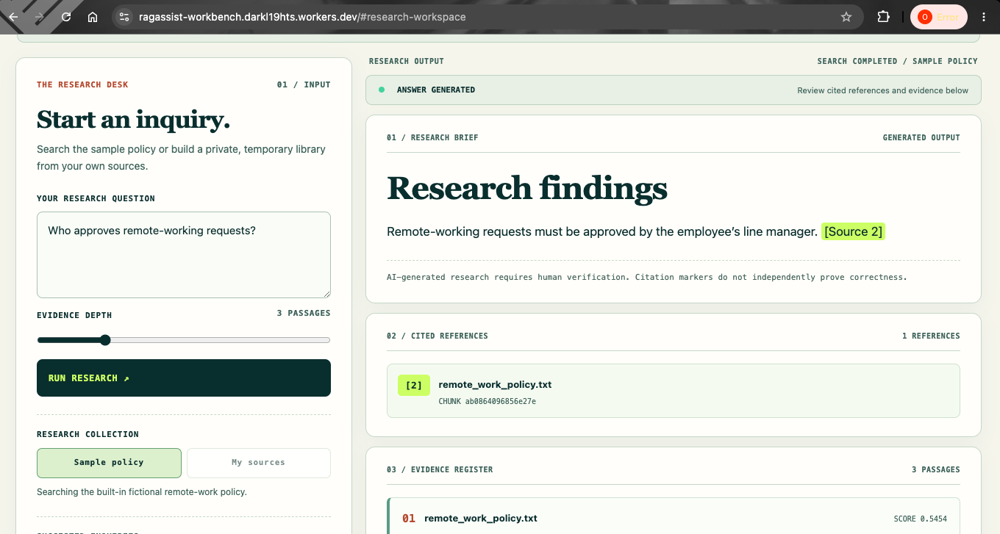

# RAGAssist — Evidence-Grounded Document Intelligence

**An end-to-end Retrieval-Augmented Generation (RAG) application for document ingestion, semantic search, and evidence-grounded question answering.**

[**Live Application**](https://ragassist-workbench.darkl19hts.workers.dev) | [API Documentation](docs/api.md) | [Evaluation Results](reports/evaluation_summary.md)

## Application Preview





## Overview

RAGAssist enables users to upload PDF and TXT documents or paste text, ask natural-language questions, and receive AI-generated answers with traceable source citations.

The application combines semantic retrieval with large language model generation, allowing users to inspect supporting document passages and assess the reliability of generated responses.

Developed as an end-to-end AI engineering project, RAGAssist demonstrates the integration of document processing, vector search, language models, REST APIs, automated evaluation, and cloud deployment.

## Key Features

- **Document ingestion:** Process text-based PDF files, TXT files, and pasted text.
- **Semantic search:** Retrieve relevant passages using Sentence Transformer embeddings and FAISS.
- **Grounded answer generation:** Generate answers using retrieved document context and a Groq-hosted language model.
- **Source citations:** Display supporting filenames, chunk identifiers, and available page references.
- **Evidence inspection:** Allow users to review retrieved passages independently of generated answers.
- **Document workspaces:** Maintain temporary uploaded-document collections separately from the demonstration dataset.
- **Evaluation framework:** Measure retrieval quality, answer correctness, citation support, abstention behaviour, and latency.
- **REST API:** Provide validated retrieval and question-answering endpoints through FastAPI.
- **Interactive web application:** Deliver a responsive Evidence Workbench through Cloudflare Pages.
- **Automated testing:** Validate components, API behaviour, and frontend functionality.

## Technology Stack

| Area | Technologies |
|---|---|
| Programming | Python, JavaScript |
| Document processing | pypdf, custom text processing |
| Embeddings | Sentence Transformers, all-MiniLM-L6-v2 |
| Vector retrieval | FAISS |
| RAG orchestration | LangChain |
| Answer generation | GroqCloud, openai/gpt-oss-20b |
| Backend | FastAPI, Pydantic, Uvicorn |
| Frontend | HTML, CSS, JavaScript |
| Testing | pytest, HTTPX, Node.js test runner |
| Deployment | Cloudflare Pages, Render |
| Version control | Git, GitHub |

## Model and Retrieval Evaluation

RAGAssist includes a reproducible evaluation framework based on a curated question set covering answerable and unanswerable queries.

### Retrieval Baseline

| Metric | Result |
|---|---:|
| Mean Recall@1 | 0.5556 |
| Mean Recall@3 | 1.0000 |
| MRR@3 | 0.8148 |
| Mean retrieval latency | 211.41 ms |

The initial retrieval evaluation used nine answerable questions and a fictional remote-working policy.

### Answer Quality

| Metric | Result |
|---|---:|
| Overall correctness | 75.0% |
| Correctness on answerable questions | 66.7% |
| Correct abstention rate on unanswerable questions | 100% |
| Incorrect abstentions | 3 |

The answer evaluation exposed a difference between successful evidence retrieval and reliable LLM answer generation, identifying unnecessary abstentions as an area for improvement.

### Retrieval Optimisation

Three chunking configurations were compared.

| Configuration | Mean Recall@1 | MRR@3 |
|---|---:|---:|
| 500 characters / 100 overlap | 0.5556 | 0.8148 |
| 300 characters / 50 overlap | 0.5556 | 0.8148 |
| 800 characters / 150 overlap | 0.8333 | 0.9444 |

The larger-chunk configuration achieved the strongest ranking metrics on the evaluation dataset. However, the small indexed collection limits the generalisability of these findings.

The 500/100 configuration remains the reference implementation pending broader evaluation.

See the detailed reports in the `reports/` directory.

## Deployment Architecture

The public frontend is hosted on Cloudflare Pages, independently of the Python backend running on Render.

This separation allows the Evidence Workbench to load promptly even when the free backend is waking after inactivity.

The backend performs document processing, embedding generation, FAISS retrieval, and LLM answer generation.

## Limitations

- The evaluation dataset contains one fictional policy and a limited number of questions.
- Generated answers can be inaccurate or unnecessarily abstain.
- Uploaded-document workspaces are temporary and may disappear after backend restarts.
- Scanned PDFs requiring OCR are not supported.
- Free backend hosting may introduce cold-start delays before research requests complete.
- The public application is intended as a controlled portfolio demonstration, not a production service for sensitive documents.

## Future Improvements

- Broader multi-document retrieval evaluation
- Stronger citation-support verification
- Improved abstention handling
- Persistent document storage
- Authentication and distributed rate limiting
- Model and application monitoring
- Automated regression evaluation

## Documentation

- [Architecture](docs/architecture.md)
- [API Reference](docs/api.md)
- [Frontend Design](docs/frontend_design.md)
- [Document Uploads](docs/document_uploads.md)
- [Retrieval Optimisation](reports/retrieval_optimisation.md)
- [Evaluation Summary](reports/evaluation_summary.md)

## Project Structure

- `data/sample_docs/` — Fictional sample documents for development and evaluation
- `src/ingestion/` — PDF and TXT document loading
- `src/chunking/` — Text splitting and metadata preservation
- `src/embeddings/` — Text embedding generation
- `src/retrieval/` — Vector search and retrieval logic
- `src/generation/` — LLM prompts and answer generation
- `src/evaluation/` — Retrieval and answer-quality evaluation
- `src/api/` — FastAPI backend
- `tests/` — Automated tests
- `docs/` — Architecture and technical documentation

## Setup

```bash
python -m venv .venv
source .venv/bin/activate
python -m pip install -r requirements.txt
python -m pytest -v
```

## Document Ingestion

RAGAssist supports text extraction from UTF-8 TXT files and text-based PDF documents.

The ingestion pipeline:

- Validates supported file types.
- Extracts document text.
- Preserves source filenames, file types and PDF page numbers.
- Skips PDF pages without extractable text.
- Exports structured document records as JSON.

Run the pipeline:

```bash
python -m src.ingestion.run_ingestion
```

The extracted records are saved to `data/processed/documents.json`.

**Current limitation:** Scanned PDFs, OCR and password-protected documents are not supported.


## Text Chunking

RAGAssist uses deterministic, overlapping character-based chunking to prepare extracted documents for semantic search.

**Current configuration:**

- Chunk size: 500 characters
- Chunk overlap: 100 characters
- Stable chunk IDs generated using SHA-256
- Preserved source filenames, file types and PDF page numbers
- Character offsets for traceability

Run the pipeline:

```bash
python -m src.ingestion.run_ingestion
python -m src.chunking.run_chunking
```

The resulting chunks are stored in `data/processed/chunks.json`.

Character-based chunking is the initial baseline. Alternative chunking strategies will be evaluated in later phases.

## Semantic Search

RAGAssist uses `sentence-transformers/all-MiniLM-L6-v2` to generate 384-dimensional document embeddings.

Embeddings are normalized and indexed using FAISS `IndexFlatIP` for cosine-similarity search.

### Build the search index

```bash
python -m src.ingestion.run_ingestion
python -m src.chunking.run_chunking
python -m src.embeddings.build_index
```

### Search documents

```bash
python -m src.retrieval.search "Can employees work abroad?" --top-k 3
```

Search results include similarity scores, source filenames, page numbers, chunk IDs and retrieved text.

The initial retrieval baseline is documented in `reports/retrieval_baseline.md`.


## LangChain Retrieval Pipeline

RAGAssist uses LangChain Core to orchestrate semantic retrieval over the existing FAISS vector index.

The retrieval pipeline:

- Embeds a natural-language question using Sentence Transformers.
- Retrieves matching document chunks from FAISS.
- Converts the results into LangChain `Document` objects.
- Preserves source filenames, page numbers, chunk IDs and similarity scores.
- Produces formatted, source-labelled context for a future LLM.

### Run Retrieval

First, build the index if necessary:

```bash
python -m src.ingestion.run_ingestion
python -m src.chunking.run_chunking
python -m src.embeddings.build_index
```

Then retrieve document passages:

```bash
python -m src.retrieval.run_retrieval \
    "Can employees work abroad?" \
    --top-k 3
```

### Automated Testing

```bash
python -m pytest -q
```

The retrieval components are tested using dependency injection and fake embedding/vector-search implementations, avoiding external model downloads during unit tests.


## Sample Data

The repository includes a fictional remote-working policy document for development and testing.

No real employee or confidential company data is required.

## Retrieval Evaluation

RAGAssist includes a reproducible evaluation pipeline
for measuring semantic-retrieval quality.

The evaluation uses curated questions and labelled
source evidence to calculate:

- Mean Recall@1
- Mean Recall@3
- Mean Reciprocal Rank at 3 (MRR@3)
- Retrieval latency

Run the evaluation:

    python -m src.evaluation.run_retrieval_eval

Results are saved to:

- `reports/retrieval_evaluation.csv`
- `reports/retrieval_evaluation.md`

The current evaluation dataset is small and based on a
fictional policy document. Results are an initial
engineering baseline, not production benchmarks.


## Answer Quality Evaluation

RAGAssist evaluates its generated answers using 12
curated questions, including unsupported questions
designed to test hallucination and abstention behaviour.

Run answer evaluation:

    python -m src.evaluation.run_answer_eval --limit 12

Manually review generated answers and their citations:

    python -m src.evaluation.review_answer_eval

Generate the evaluation summary:

    python -m src.evaluation.summarize_answer_eval

The evaluation records:

- Answer correctness
- Citation support
- Correct and incorrect abstentions
- Unsupported-answer events
- End-to-end response latency

See `reports/evaluation_summary.md` for results.

The current dataset is small and fictional. These results
are an initial engineering baseline, not a production
reliability guarantee.


## Retrieval Optimisation

RAGAssist includes controlled experiments comparing character-based text chunking configurations.

The experiments measure:

- Recall@1 and Recall@3
- Mean Reciprocal Rank at 3 (MRR@3)
- Availability of labelled supporting evidence
- Query retrieval latency
- Number of indexed document chunks

Run the comparison:

```bash
python -m src.evaluation.compare_retrieval
```

Results are saved in `reports/retrieval_comparison.csv` and `reports/retrieval_comparison_details.csv`.

The experimental findings and configuration trade-offs are documented in `reports/retrieval_optimisation.md`.

The comparison uses the same source documents and evaluation questions for each configuration and does not modify the application's saved FAISS index.


## REST API

RAGAssist provides a FastAPI backend for semantic retrieval and source-grounded question answering.

### Available Endpoints

| Method | Endpoint | Purpose |
|---|---|---|
| GET | `/health` | API liveness check |
| POST | `/retrieve` | Retrieve relevant document passages |
| POST | `/ask` | Generate an evidence-grounded answer |

### Run Locally

```bash
python -m uvicorn src.api.main:app --host 0.0.0.0 --port 8000 --reload
```

Interactive API documentation is available at:

`http://localhost:8000/docs`

### Automated Tests

```bash
python -m pytest tests/test_api.py -v
```

The API uses dependency injection to isolate inference logic during testing, avoiding external LLM requests and model downloads.

See `docs/api.md` for request schemas, response examples, error handling and operational limitations.

## Evidence Workbench

RAGAssist includes a custom-designed Gradio research interface for exploring indexed documents and verifying AI-generated answers.

The interface uses an editorial-style workspace rather than a conventional conversational layout.

**Key capabilities**

- Research-focused question input and suggested inquiries
- Configurable semantic retrieval depth
- Structured research briefs
- Source citation references
- Independently inspectable retrieved evidence
- Explicit answer and error statuses
- Responsive layout and custom visual styling
- HTML-escaped rendering of generated answers and source content

The frontend communicates with the existing FastAPI service through HTTP requests.

### Run Locally

Start the backend:

```bash
python -m uvicorn src.api.main:app --host 0.0.0.0 --port 8000
```

Start the frontend in a second terminal:

```bash
python -m src.frontend.app
```

Open `http://localhost:7860`.

Design details are documented in `docs/frontend_design.md`.

## Upload Documents and Paste Text

RAGAssist includes a session-scoped document workspace. Upload selectable-text
PDFs or UTF-8 TXT files, or paste text, to create a temporary searchable FAISS
index. Questions are answered from **the uploaded workspace only**, without
mixing sources from the bundled demonstration policy. Source citations and
retrieved evidence remain visible in the Gradio research workbench.

Start FastAPI and the frontend in separate terminals:

```bash
python -m uvicorn src.api.main:app --host 0.0.0.0 --port 8000
python -m src.frontend.app
```

Open the Gradio interface at `http://localhost:7860`, expand **Add Your Source
Material**, index files or pasted text, and ask a question. Click **Remove
uploaded sources / use demo** to clear the temporary index.

Maximum 5 MB per file, 10 sources and 40 pages per PDF. Workspaces live in a
single backend process's memory and expire after 30 minutes of inactivity.
Text-only PDFs are supported; OCR for scanned PDFs is not implemented.

**Privacy:** Uploaded documents may be sent as retrieved passages to the Groq
LLM for answer generation. This is a development demo without public-user
authentication or rate limiting. Keep its ports private and use non-sensitive
documents only.

See [Document Uploads](docs/document_uploads.md) for the API, storage behaviour,
limits, tests and security considerations.

## Static Evidence Workbench

RAGAssist includes a lightweight, custom HTML/CSS/JavaScript research interface (`web/`) that can be deployed independently on Cloudflare Pages. The original Gradio frontend remains available for local development.

The static website loads from CDN assets while the Python document-processing backend connects. It provides source-aware research briefs, cited references, an evidence register, PDF/TXT uploads, and pasted-text indexing. It displays useful progress states when a free backend is waking after inactivity. The backend still needs to be running before it can answer questions.

Run the static interface locally:

```bash
python -m http.server 5500 --directory web
```

Start the existing FastAPI service separately on port 8000 and set `apiBaseUrl: 'http://127.0.0.1:8000'` in `web/config.js` for local testing. Include `http://localhost:5500` and/or `http://127.0.0.1:5500` in `CORS_ALLOWED_ORIGINS` for local browser requests.

See [Static deployment guide](docs/static_deployment.md) for Cloudflare Pages, Render, CORS configuration, and deployment limitations.


# Email: olamideolaitan111@gmail.com